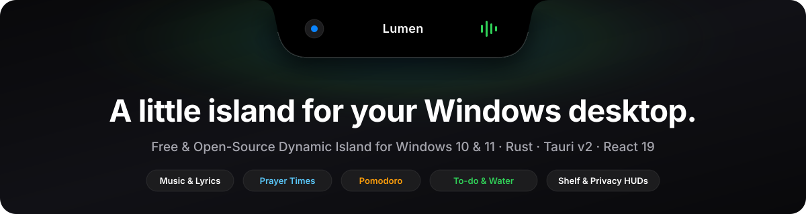

<div align="center">



# Lumen — Dynamic Island for Windows 10 & 11

**A little island for your desktop.**  
Free, open-source, privacy-first Dynamic Island & notch overlay for **Windows 10 (1809+)** and **Windows 11** — built with **Rust**, **Tauri v2**, and **React 19**.

[](./LICENSE)
[-0A84FF?style=for-the-badge&logo=windows>)](https://github.com/devabunayem/lumen)
[](https://tauri.app/)
[](https://react.dev/)
[](./SECURITY.md)

[Features](#features) · [Architecture](#architecture) · [Build from Source](#getting-started) · [Roadmap](#delivery-roadmap) · [Contributing](./CONTRIBUTING.md)

</div>

---

## Why Lumen?

Lumen brings a calm, pure-black (`#000000`), spring-animated **Dynamic Island / desktop notch** to the top-centre of your Windows screen — without paywalls, cloud accounts, or telemetry.

- **100% Free & Open Source (MIT):** Every widget, theme customization, Pomodoro timer, and system HUD is included out of the box.
- **Ultra-Light Native Core:** Powered by Rust (`windows-rs`, `tokio`, `SQLite`) and Tauri v2, targeting **< 1% idle CPU** and **< 120 MB RAM** (80 MB target).
- **Privacy-First by Design:** Zero analytics or tracking. Notifications support preview hiding, per-app allow/deny lists, keyword masking, and automatic hiding during screen sharing.
- **Prayer Times as a First-Class Widget:** Offline Islamic prayer calculations (`adhan` crate) with Bangladesh defaults, Bangla (`বাংলা`) UI support, sun-arc chart, and optional Ramadan Sehri/Iftar countdown.
- **Extensible Plugin & Widget SDK:** Community-driven sandboxed web widgets with explicit permission manifests.

---

## Features

| Widget / Capability             | Highlights                                                                                                                                                                      |
| ------------------------------- | ------------------------------------------------------------------------------------------------------------------------------------------------------------------------------- |
| **Music & Synced Lyrics**       | Universal Windows SMTC media controls (Spotify, browsers, local players), album-art accent extraction, animated waveform live activity, offline-cached synced lyrics via LRCLIB |
| **Offline Prayer Times**        | Accurate offline calculations (`adhan`), preloaded cities (Dhaka, Khulna & more), English/Bangla names, Hijri date, sun-arc timeline, adhan reminders                           |
| **Pomodoro Focus Timer**        | Configurable focus, short break, and long break cycles, live orange countdown ring in the collapsed pill, daily focus statistics                                                |
| **To-Do List**                  | Fast inline task creation, due-time reminders, calendar due indicator, local SQLite persistence with JSON export/import                                                         |
| **Water Tracker**               | Editable daily hydration goal (default 1.5 L), circular gradient gauge, quick 250 ml logging with 5-second undo, weekly history                                                 |
| **File & Link Shelf**           | Drag files, folders, text, or URLs straight onto the pill — referenced locally without copying                                                                                  |
| **Privacy-First Notifications** | Pill toast popups with click-to-focus, swipe-to-dismiss, screen-share auto-silence, Focus Assist sync, sensitive keyword masking                                                |
| **System HUDs**                 | Compact 64 px popups for Volume, Brightness, Mute, Caps Lock, Battery/Charging, Bluetooth, Do Not Disturb, and Mic/Camera indicators                                            |
| **Optional Ask (AI)**           | Bring-your-own API key stored strictly in Windows Credential Manager (disabled with zero network calls unless configured)                                                       |

---

## Tech Stack

- **App Shell & Backend:** [Tauri v2](https://tauri.app/), Rust (`tokio`, `windows-rs`, `rusqlite`, `adhan`)
- **Frontend UI:** **React 19** (`^19.3`), TypeScript, Vite, Tailwind CSS v4 (CSS Variable Design Tokens)
- **Animation & State:** [Motion](https://motion.dev/) (physics-based springs + Windows Reduce Motion support), Zustand, deterministic finite state machine
- **Typography:** Bundled Inter Variable (`@fontsource-variable/inter`) with tabular numerals
- **Localization:** English (`en`) and Bangla (`bn`) JSON catalogs

---

## Architecture

System integrations, Windows APIs, persistence, and timers live inside modular Rust crates under `src-tauri/crates/`. React 19 renders state and dispatches typed Tauri IPC commands without directly invoking OS APIs.

```text
lumen/
├─ src-tauri/
│  ├─ crates/
│  │  ├─ lumen-core/      # Deterministic island state machine, event bus, settings
│  │  ├─ lumen-windows/   # Transparent top-centre window, hit-testing, fullscreen, monitors
│  │  ├─ lumen-media/     # Windows SMTC media bridge, volume, LRCLIB cache
│  │  ├─ lumen-prayer/    # Offline adhan wrapper, locations, reminders
│  │  ├─ lumen-notify/    # Toast notification pipeline & privacy filters
│  │  ├─ lumen-storage/   # SQLite persistence, migrations, JSON export/import
│  │  └─ lumen-plugins/   # Widget manifest, permission checks, sandbox loader
│  └─ src/                # Tauri commands & app wiring
├─ src/
│  ├─ app/                # Island shell & finite state machine hooks
│  ├─ design/             # Colour tokens, continuous squircle paths, Motion spring presets
│  ├─ widgets/            # Built-in widgets & FR-PL-1 TypeScript widget contract
│  ├─ settings/           # Separate Settings window UI
│  ├─ i18n/               # en.json, bn.json
│  └─ lib/                # Typed IPC client & utilities
└─ docs/                  # Architecture, design system & decision records
```

---

## Getting Started

### Prerequisites

- Windows 10 (1809+) or Windows 11 (x64 / ARM64)
- [Rust](https://www.rust-lang.org/tools/install) (with `rustfmt` and `clippy`)
- [Node.js](https://nodejs.org/) 20+ & [pnpm](https://pnpm.io/)
- Visual Studio C++ Build Tools & Microsoft Edge WebView2 Runtime

### Run in Development Mode

```bash
git clone https://github.com/devabunayem/lumen.git
cd lumen
pnpm install
pnpm tauri dev
```

### Run Checks & Tests

```bash
pnpm lint
pnpm format:check
pnpm typecheck
pnpm test
cargo fmt --manifest-path src-tauri/Cargo.toml --all -- --check
cargo clippy --manifest-path src-tauri/Cargo.toml --workspace --all-targets -- -D warnings
cargo test --manifest-path src-tauri/Cargo.toml --workspace
```

---

## Delivery Roadmap

| Phase       | Milestone                                                                       | Status     |
| ----------- | ------------------------------------------------------------------------------- | ---------- |
| **Phase 0** | Repo, CI, design tokens, Tauri v2 + React 19 skeleton & top-centre pill         | ✅ Done    |
| **Phase 1** | Click-through window engine, fullscreen auto-hide, Notch ↔ Pill spring morphing | ✅ Done    |
| **Phase 2** | Music widget with Windows SMTC, controls & waveform live activity               | 🚧 Next    |
| **Phase 3** | SQLite storage, To-do, Water Tracker & Offline Prayer Times                     | ⏳ Planned |
| **Phase 4** | Pomodoro timer, File Shelf, System HUDs & Synced Lyrics                         | ⏳ Planned |
| **Phase 5** | Privacy-first Windows Notifications pipeline                                    | ⏳ Planned |
| **Phase 6** | Settings window, multi-monitor DPI, Bangla i18n & Accessibility pass            | ⏳ Planned |
| **Phase 7** | Third-party Plugin SDK, signed MSI/NSIS installer (`v1.0.0`), Winget & Scoop    | ⏳ Planned |
| **Phase 8** | Ask (BYO-key AI), Weather, Calendar, Clipboard & System Stats widgets           | ⏳ Planned |

---

## Privacy & License

Lumen makes **zero telemetry or analytics calls**. Network requests occur solely for user-initiated features (synced lyrics lookup, update checks, or user-configured AI endpoints).

Released under the [MIT License](./LICENSE) by **Abu Nayem (Etarnity Global Innovation)**.
